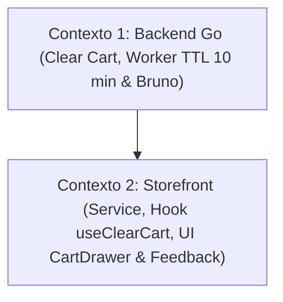

# 📐 Plano de Execução Técnica: Melhorias no Carrinho (Esvaziar Carrinho & Expiração Automática de 10 min)

Este plano técnico foi formulado pelo **Nexus Tech Planner** para implementar as funcionalidades de **esvaziamento atômico do carrinho** e **limpeza/expiração automática de carrinhos inativos após 10 minutos** (com suporte à transição futura para 24h), concebido como uma melhoria desacoplada e complementar ao carrinho anônimo, respeitando integralmente as diretrizes de [`rules/RESTRICTIONS.md`](../../rules/RESTRICTIONS.md).

---

## 1. Visão Geral e Estratégia de Contextos

- **Resumo da Entrega:**
  1. **Esvaziar Carrinho (`DELETE /api/store/cart`):** Capacidade de remover todos os itens de uma sessão de forma atômica com uma única requisição. Atualiza `updated_at` do carrinho, zera o subtotal e atualiza a interface instantaneamente através de botão no cabeçalho do `CartDrawer`.
  2. **Expiração Automática de Carrinhos Inativos (TTL de 10 minutos):**
     - **Banco de Dados (SQL Nativo):** Índice `idx_carts_updated_at` para otimização de consultas de expurgo por tempo e exclusão automática de itens vinculados via `ON DELETE CASCADE`.
     - **Dupla Proteção no Backend Go:**
       - **Worker em Segundo Plano:** Goroutine com `time.NewTicker` executando periodicamente a limpeza de carrinhos com `updated_at < NOW() - 10 min`, com threshold parametrizável via constante `DefaultCartInactiveThreshold = 10 * time.Minute` (preparado para ser alterado para 24h).
       - **Validação Just-in-Time (Lazy Expiration):** Ao buscar o carrinho (`GetCartBySessionID`), caso tenha ultrapassado 10 minutos sem atualização, é automaticamente excluído e recriado zerado.
       - **Endpoint Manual de Manutenção:** `POST /api/store/cart/cleanup` para testes manuais e asserções automatizadas no Bruno.
- **Nível de Complexidade:** **Média** (Envolve concorrência em Go com goroutines/tickers, SQL com índices temporais e interações no frontend).
- **Quantidade de Contextos/Sessões:** **2 Contextos Isolados**.
- **Grafo de Dependência:**



---

## 2. Checklist Técnico Global (`[ ]`)

- [ ] **Banco de Dados & Migração (`apps/backend/migrations/03-create-carts.sql`)**:
  - [ ] Adicionar índice `CREATE INDEX IF NOT EXISTS idx_carts_updated_at ON carts(updated_at);` para otimização do expurgo por tempo.
- [ ] **Repositório Go (`apps/backend/postgres/carts.go`)**:
  - [ ] Definir a constante `DefaultCartInactiveThreshold = 10 * time.Minute`.
  - [ ] Implementar `ClearCart(ctx context.Context, sessionID string) (*Cart, error)` deletando todos os itens vinculados ao `cart_id` da sessão e atualizando `carts.updated_at`.
  - [ ] Implementar `DeleteInactiveCarts(ctx context.Context, olderThan time.Duration) (int64, error)` com `DELETE FROM carts WHERE updated_at < $1`.
  - [ ] No método `GetCartBySessionID`, adicionar verificação lazy: se `time.Since(cart.UpdatedAt) > threshold`, invocar exclusão e retornar carrinho novo zerado.
  - [ ] Registrar assinaturas na interface `Storage` em `postgres/store.go`.
- [ ] **Serviço HTTP, Worker & Rotas (`apps/backend/service/` e `apps/backend/routers/`)**:
  - [ ] Implementar `HandleClearCart(c *gin.Context)` em `service/cart.go` mapeado para `DELETE /api/store/cart`.
  - [ ] Criar worker `StartCartCleanerWorker(ctx context.Context, interval, threshold time.Duration)` em `service/cart_cleaner.go` utilizando `time.Ticker` e estruturando logs com `slog.Info`.
  - [ ] Implementar endpoint de trigger manual `HandleCleanupInactiveCarts(c *gin.Context)` em `service/cart.go` (`POST /api/store/cart/cleanup`).
  - [ ] Inicializar o worker de limpeza na inicialização do servidor em `cmd/api.go`.
- [ ] **API Collection no Bruno (`apps/backend/bruno/store/cart/`)**:
  - [ ] Criar `Clear Cart.bru` testando esvaziamento completo (`res.status: eq 200`, itens vazios e subtotal zero).
  - [ ] Criar `Cleanup Inactive Carts.bru` testando a rotina de exclusão sob demanda.
- [ ] **Storefront (`apps/frontend/storefront/`)**:
  - [ ] Adicionar `clearCart(): Promise<Cart>` em `src/shared/services/cart.ts`.
  - [ ] Criar hook `useClearCart()` em `src/shared/hooks/useCart.ts` com invalidação de cache `['store-cart']`.
  - [ ] Adicionar botão "Esvaziar carrinho" no cabeçalho do `CartDrawer` com confirmação visual para prevenir cliques involuntários.
  - [ ] Testes unitários Jest cobrindo o esvaziamento do carrinho e reset do estado.

---

## 3. Prompts de Execução para Agentes (Ready-to-Run)

### Contexto 1: Backend Go (Esvaziar Carrinho, Worker TTL 10 min & Bruno)

```markdown
### AGENTE ALVO: backend-specialist

Você deve implementar o endpoint de esvaziamento do carrinho (`DELETE /api/store/cart`) e a rotina de expiração automática de carrinhos inativos após 10 minutos (com worker em background e verificação just-in-time) no Backend Go.

#### Contexto & Diretrizes do Repositório
- Diretório de trabalho: `apps/backend/`.
- Regras Críticas:
  - Respeitar estritamente `rules/RESTRICTIONS.md`.
  - Proibido o uso de ORMs (usar estritamente `database/sql` e Raw SQL).
  - O limiar de inatividade deve ser configurado como constante centralizada: `const DefaultCartInactiveThreshold = 10 * time.Minute` (preparado para ser alterado para 24h futuramente).
  - Obrigatoriedade de testes no Bruno (`apps/backend/bruno/store/cart/`).
- Skills Obrigatórias a consultar:
  - `skills/backend/golang-database-repository/SKILL.md`
  - `skills/backend/golang-error-handling/SKILL.md`
  - `skills/backend/golang-api-architecture/SKILL.md`
  - `skills/backend/bruno-collection-generator/SKILL.md`

#### Instruções Técnicas Passo a Passo

1. **Migration SQL (`apps/backend/migrations/03-create-carts.sql`)**:
   - Garantir a presença do índice temporal:
     ```sql
     CREATE INDEX IF NOT EXISTS idx_carts_updated_at ON carts(updated_at);
     ```

2. **Repositório de Banco de Dados (`apps/backend/postgres/carts.go`)**:
   - Definir a constante de inatividade:
     ```go
     const DefaultCartInactiveThreshold = 10 * time.Minute
     ```
   - Implementar método `ClearCart`:
     ```go
     func (s *Store) ClearCart(ctx context.Context, sessionID string) (*Cart, error) {
         query := `
             DELETE FROM cart_items
             WHERE cart_id = (SELECT id FROM carts WHERE session_id = $1)
         `
         if _, err := s.db.ExecContext(ctx, query, sessionID); err != nil {
             return nil, fmt.Errorf("failed to clear cart items: %w", err)
         }

         updateQuery := `
             UPDATE carts
             SET updated_at = CURRENT_TIMESTAMP
             WHERE session_id = $1
         `
         _, _ = s.db.ExecContext(ctx, updateQuery, sessionID)

         return s.GetCartBySessionID(ctx, sessionID)
     }
     ```
   - Implementar método `DeleteInactiveCarts`:
     ```go
     func (s *Store) DeleteInactiveCarts(ctx context.Context, olderThan time.Duration) (int64, error) {
         cutoff := time.Now().UTC().Add(-olderThan)
         query := `DELETE FROM carts WHERE updated_at < $1`

         result, err := s.db.ExecContext(ctx, query, cutoff)
         if err != nil {
             return 0, fmt.Errorf("failed to delete inactive carts: %w", err)
         }

         rowsAffected, err := result.RowsAffected()
         if err != nil {
             return 0, fmt.Errorf("failed to get rows affected: %w", err)
         }

         return rowsAffected, nil
     }
     ```
   - No método `GetCartBySessionID`, validar inatividade (Lazy Expiration):
     Se o carrinho existir e `time.Since(cart.UpdatedAt) > DefaultCartInactiveThreshold`:
     - Executar `s.db.ExecContext(ctx, "DELETE FROM carts WHERE id = $1", cart.ID)`
     - Retornar um carrinho vazio limpo recém-inicializado.
   - Atualizar a interface `Storage` em `postgres/store.go`.

3. **Worker de Limpeza em Background (`apps/backend/service/cart_cleaner.go`)**:
   - Criar arquivo com a função do worker:
     ```go
     package service

     import (
         "context"
         "log/slog"
         "time"
         "github.com/nexus-commerce/backend/postgres"
     )

     func (s *Service) StartCartCleanerWorker(ctx context.Context, interval time.Duration, threshold time.Duration) {
         ticker := time.NewTicker(interval)
         slog.Info("Cart cleaner background worker started", "interval", interval.String(), "threshold", threshold.String())

         go func() {
             for {
                 select {
                 case <-ticker.C:
                     count, err := s.store.DeleteInactiveCarts(ctx, threshold)
                     if err != nil {
                         slog.Error("Failed to clean up inactive carts", "error", err)
                     } else if count > 0 {
                         slog.Info("Cleaned up inactive carts", "deleted_count", count)
                     }
                 case <-ctx.Done():
                     ticker.Stop()
                     slog.Info("Cart cleaner background worker stopped")
                     return
                 }
             }
         }()
     }
     ```

4. **Camada de Serviço HTTP (`apps/backend/service/cart.go`)**:
   - Implementar `HandleClearCart(c *gin.Context)`:
     - Extrair `sessionID` do header `X-Session-ID`.
     - Invocar `cart, err := s.store.ClearCart(c.Request.Context(), sessionID)`.
     - Responder HTTP 200 OK com `s.HandleResponseAPIOK(c, cart, "Cart cleared successfully")`.
   - Implementar `HandleCleanupInactiveCarts(c *gin.Context)`:
     - Invocar `count, err := s.store.DeleteInactiveCarts(c.Request.Context(), postgres.DefaultCartInactiveThreshold)`.
     - Retornar HTTP 200 OK com `gin.H{"deleted_carts": count, "threshold": "10m"}`.

5. **Roteamento & Inicialização (`apps/backend/routers/routers.go` e `cmd/api.go`)**:
   - Em `routers/routers.go`:
     - `store.DELETE("/cart", svc.HandleClearCart)`
     - `store.POST("/cart/cleanup", svc.HandleCleanupInactiveCarts)`
   - Em `cmd/api.go`:
     - Antes de iniciar `r.Run(addr)`, chamar `svc.StartCartCleanerWorker(context.Background(), 1*time.Minute, postgres.DefaultCartInactiveThreshold)`.

6. **Bruno API Collection (`apps/backend/bruno/store/cart/`)**:
   - Criar `Clear Cart.bru` (`DELETE {{baseUrl}}/api/store/cart` com header `X-Session-ID`).
     - Assert: `res.status: eq 200`, `res.body.data.subtotal: eq 0`.
   - Criar `Cleanup Inactive Carts.bru` (`POST {{baseUrl}}/api/store/cart/cleanup`).
     - Assert: `res.status: eq 200`.

#### Validação e Critérios de Sucesso
- Executar `go build ./...` garantindo compilação sem falhas.
- Executar testes via Bruno comprovando que `DELETE /api/store/cart` zera o carrinho e que a limpeza manual e automática remove registros com mais de 10 minutos.
```

---

### Contexto 2: Storefront (Service, Hook useClearCart & UI CartDrawer)

```markdown
### AGENTE ALVO: frontend-specialist

Você deve integrar a opção de "Esvaziar Carrinho" (limpar todos os itens) no Storefront, conectando o serviço de API, o hook de mutação e a interface no `CartDrawer`.

#### Contexto & Dependências
- Backend com `DELETE /api/store/cart` disponível e respondendo HTTP 200 com carrinho limpo.
- Diretório de trabalho: `apps/frontend/storefront/`.
- Stack: React 19, Next.js Pages Router, TailwindCSS + CSS Modules, Lucide React e TanStack Query v5.
- Regras Críticas:
  - Respeitar estritamente `rules/RESTRICTIONS.md`.
  - Manter funções puras em `src/shared/services/` e hooks em `src/shared/hooks/`.
  - Feedback amigável para o usuário: botão com estado de carregamento e confirmação rápida para evitar cliques acidentais.
- Skills Obrigatórias a consultar:
  - `skills/frontend/design/SKILL.md`
  - `skills/frontend/web-interface-guidelines/SKILL.md`
  - `skills/frontend/react/SKILL.md`

#### Instruções Técnicas Passo a Passo

1. **Serviço de API (`src/shared/services/cart.ts`)**:
   - Implementar a função `clearCart`:
     ```typescript
     export const clearCart = async (): Promise<Cart> => {
       try {
         const response = await apiClient.delete<ApiResponse<Cart>>('/api/store/cart')
         const apiResponse = response?.data
         if (!apiResponse?.success || !apiResponse?.data) {
           throw new Error(apiResponse?.message || 'Failed to clear cart')
         }
         return apiResponse.data
       } catch (error: any) {
         const hasMessage = Boolean(error?.response?.data?.message)
         if (hasMessage) throw new Error(error.response.data.message)
         throw error instanceof Error ? error : new Error('Failed to clear cart')
       }
     }
     ```

2. **Hook TanStack Query (`src/shared/hooks/useCart.ts`)**:
   - Exportar o hook `useClearCart`:
     ```typescript
     export const useClearCart = () => {
       const queryClient = useQueryClient()

       return useMutation({
         mutationFn: clearCart,
         onSuccess: (clearedCart) => {
           queryClient.setQueryData(['store-cart'], clearedCart)
           queryClient.invalidateQueries({ queryKey: ['store-cart'] })
         },
       })
     }
     ```

3. **Interface do `CartDrawer` (`src/shared/components/CartDrawer/index.tsx`)**:
   - Se houver 1 ou mais itens no carrinho:
     - Exibir na barra de topo (ou acima da lista de produtos) um botão secundário/discreto: "Esvaziar carrinho" com ícone `Trash2` em tamanho pequeno (`14px`).
     - Ao clicar pela primeira vez, solicitar confirmação inline (ex: "Tem certeza? [Sim, esvaziar] [Cancelar]") ou executar a mutação com visual feedback desabilitando as interações enquanto `isPending` estiver ativo.
     - Após esvaziar, o carrinho transiciona suavemente para o estado vazio já existente.

4. **Testes Unitários Jest (`src/shared/components/CartDrawer/__tests__/index.test.tsx`)**:
   - Testar que o botão "Esvaziar carrinho" é exibido somente quando há itens no carrinho.
   - Testar que ao clicar no botão, a função de mutação é disparada.
   - Testar que o estado vazio é exibido após o sucesso.

#### Validação e Critérios de Sucesso
- Executar `npm test` no storefront confirmando que 100% dos testes passam sem erros.
```
