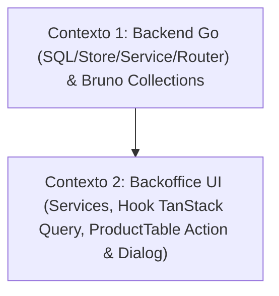

# 📐 Plano de Execução Técnica: Remoção de Produto no Catálogo (Vertical Slicing)

Este plano técnico foi formulado pelo **Nexus Tech Planner** para implementar a funcionalidade de remoção/exclusão de produto no banco de dados e expor essa capacidade via API REST, estendendo-a de ponta a ponta até a interface administrativa do **Backoffice**, respeitando estritamente as diretrizes de [`rules/RESTRICTIONS.md`](../../rules/RESTRICTIONS.md).

---

## 1. Visão Geral e Estratégia de Contextos

- **Resumo da Entrega:**
  1. **Banco de Dados & Storage (Go / Raw SQL):** Implementação do método `DeleteProduct` na camada de repositório PostgreSQL utilizando SQL nativo, com tratamento de concorrência e retorno de `ErrProductNotFound` caso o ID não exista ou já tenha sido removido. Remoção segura do arquivo de imagem vinculado na pasta `uploads/` se for um upload local.
  2. **API & Roteamento (Go / Gin):** Criação do handler `HandleDeleteProduct` no serviço administrativo, validação do formato UUID no path parameter `/api/admin/products/:id`, tratamento padronizado de respostas (HTTP 200 para sucesso, HTTP 400 para UUID inválido, HTTP 404 para item não encontrado e HTTP 500 para falhas internas).
  3. **Bruno API Collection:** Criação das requisições declarativas de teste automatizado em `apps/backend/bruno/admin/` para cenários de sucesso e recursos inexistentes.
  4. **Frontend Backoffice (React 19 / Chakra UI v3 / TanStack Query):** Criação da função de serviço `deleteAdminProduct`, hook de mutação `useDeleteAdminProduct` com invalidação automática de cache (`['admin-products']`), adição da coluna de ações com botão de exclusão na `ProductTable`, diálogo acessível de confirmação e testes unitários.
- **Nível de Complexidade:** **Média** (Vertical slice completo envolvendo Banco de Dados, Backend Go, Bruno Collections e UI React com diálogo de confirmação).
- **Quantidade de Contextos/Sessões:** **2 Contextos Isolados**.
- **Grafo de Dependência:**



---

## 2. Checklist Técnico Global (`[ ]`)

- [ ] **Camada de Banco de Dados & Storage Go (`apps/backend/postgres/`)**:
  - [ ] Declarar `ErrProductNotFound = errors.New("product not found")` em `postgres/products.go`.
  - [ ] Atualizar o contrato da interface `Storage` em `postgres/store.go` com `DeleteProduct(ctx context.Context, id string) (*Product, error)`.
  - [ ] Implementar `DeleteProduct` utilizando Raw SQL (`DELETE FROM products WHERE id = $1 RETURNING id, name, image_url`) para validar existência e capturar o caminho da imagem excluída.
  - [ ] Validar `sql.ErrNoRows` convertendo-o para `ErrProductNotFound`.
- [ ] **Camada de Serviço & Handlers HTTP (`apps/backend/service/`)**:
  - [ ] Implementar `HandleDeleteProduct(c *gin.Context)` em `service/products.go`.
  - [ ] Validar formato UUID do path param `id` via `uuid.Parse(id)` retornando HTTP 400 se inválido.
  - [ ] Invocar `s.store.DeleteProduct(c.Request.Context(), id)` tratando `ErrProductNotFound` com HTTP 404 Not Found.
  - [ ] Limpar de forma assíncrona/segura o arquivo de imagem do disco caso resida no diretório local `./uploads/`.
  - [ ] Retornar HTTP 200 OK com payload padronizado `{ "success": true, "message": "Product deleted successfully" }`.
- [ ] **Roteamento & CORS (`apps/backend/routers/`)**:
  - [ ] Registrar a rota `admin.DELETE("/products/:id", svc.HandleDeleteProduct)` em `routers/routers.go`.
- [ ] **Coleção de Testes no Bruno (`apps/backend/bruno/admin/`)**:
  - [ ] Criar requisição `Delete Product.bru` testando exclusão com sucesso (`res.status: in [200, 404]`).
  - [ ] Criar requisição `Delete Product - Not Found.bru` testando ID inexistente (`res.status: eq 404`).
- [ ] **Integração no Frontend Backoffice (`apps/frontend/backoffice/`)**:
  - [ ] Adicionar função `deleteAdminProduct(id: string): Promise<void>` em `src/shared/services/products.ts`.
  - [ ] Criar hook `useDeleteAdminProduct` em `src/shared/hooks/useAdminProducts.ts` invalidando a query `['admin-products']`.
  - [ ] Adicionar coluna "Ações" e botão de remoção na `ProductTable`.
  - [ ] Implementar diálogo de confirmação antes da exclusão (evitando remoção acidental, com indicador de carregamento e acessibilidade ARIA).
  - [ ] Atualizar suíte de testes unitários Jest em `ProductTable` cobrindo o acionamento e confirmação de exclusão.

---

## 3. Prompts de Execução para Agentes (Ready-to-Run)

### Contexto 1: Banco de Dados, Handlers Go & Bruno Collection

```markdown
### AGENTE ALVO: backend-specialist

Você deve implementar a remoção de produtos no Backend Go via Raw SQL e expor o endpoint REST administrativo DELETE, acompanhado dos testes de API no Bruno.

#### Contexto & Diretrizes do Repositório
- Diretório de trabalho: `apps/backend/`.
- Regras Críticas:
  - Ler e respeitar estritamente `rules/RESTRICTIONS.md`.
  - Proibido o uso de ORMs (usar estritamente `database/sql` e Raw SQL com prepared statements e placeholders `$1`).
  - Proibido idioma português no código (variáveis, mensagens de log, métodos e queries em inglês).
  - Obrigatoriedade de API Collection no Bruno (`apps/backend/bruno/admin/`).
  - Seguir a regra de single error handling: logar OU retornar, nunca ambos. Usar `slog` estruturado.
- Skills Obrigatórias a consultar:
  - `skills/backend/golang-database-repository/SKILL.md`
  - `skills/backend/golang-api-architecture/SKILL.md`
  - `skills/backend/golang-error-handling/SKILL.md`
  - `skills/backend/bruno-collection-generator/SKILL.md`
  - `skills/backend/bruno-test-writer/SKILL.md`

#### Instruções Técnicas Passo a Passo

1. **Repositório de Banco de Dados (`apps/backend/postgres/`)**:
   - Em `postgres/products.go`:
     - Declarar erro sentinela: `var ErrProductNotFound = errors.New("product not found")`.
     - Implementar o método:
       ```go
       func (s *Store) DeleteProduct(ctx context.Context, id string) (*Product, error) {
           query := `
               DELETE FROM products
               WHERE id = $1
               RETURNING id, name, image_url
           `
           var p Product
           err := s.db.QueryRowContext(ctx, query, id).Scan(&p.ID, &p.Name, &p.ImageURL)
           if err != nil {
               if errors.Is(err, sql.ErrNoRows) {
                   return nil, ErrProductNotFound
               }
               return nil, fmt.Errorf("failed to delete product: %w", err)
           }
           return &p, nil
       }
       ```
   - Em `postgres/store.go`:
     - Adicionar à interface `Storage`:
       `DeleteProduct(ctx context.Context, id string) (*Product, error)`

2. **Camada de Serviço HTTP (`apps/backend/service/`)**:
   - Em `service/products.go`:
     - Implementar o handler `HandleDeleteProduct(c *gin.Context)`:
       - Extrair `id := strings.TrimSpace(c.Param("id"))`.
       - Validar formato UUID: `if _, err := uuid.Parse(id); err != nil { s.HandleResponseError(c, "Invalid product ID format", err); return }`.
       - Invocar `deletedProduct, err := s.store.DeleteProduct(c.Request.Context(), id)`.
       - Se `errors.Is(err, postgres.ErrProductNotFound)`:
         - Responder HTTP 404: `c.JSON(http.StatusNotFound, Response{Message: "Product not found", Error: true})`.
         - Retornar.
       - Se outro erro: `s.HandleResponseError(c, "", err)` e retornar.
       - Cleanup de arquivo local: se `deletedProduct.ImageURL` contiver `/uploads/` e não for URL externa, verificar existência e remover com `os.Remove(filepath.Join(".", deletedProduct.ImageURL))` logando advertência com `slog.Warn` se falhar.
       - Responder sucesso HTTP 200: `s.HandleResponseAPIOK(c, nil, "Product deleted successfully")`.

3. **Roteamento (`apps/backend/routers/routers.go`)**:
   - Dentro do grupo `admin := api.Group("/admin")`, registrar:
     `admin.DELETE("/products/:id", svc.HandleDeleteProduct)`

4. **API Collection no Bruno (`apps/backend/bruno/admin/`)**:
   - Criar `apps/backend/bruno/admin/Delete Product.bru`:
     - Método: `DELETE`
     - URL: `{{baseUrl}}/api/admin/products/00000000-0000-0000-0000-000000000000`
     - Assert: `res.status: in [200, 404]`
     - Docs explicando o comportamento do endpoint administrativo.
   - Criar `apps/backend/bruno/admin/Delete Product - Not Found.bru`:
     - URL: `{{baseUrl}}/api/admin/products/a0000000-0000-0000-0000-000000000000`
     - Assert:
       - `res.status: eq 404`
       - `res.body.error: eq true`

#### Validação e Critérios de Sucesso
- Executar `go build ./...` no diretório `apps/backend` garantindo compilação sem erros.
- Iniciar o servidor local ou rodar os testes/verificações do Bruno via CLI (`bru run apps/backend/bruno/admin`).
```

---

### Contexto 2: Interface Backoffice (Service, Hook TanStack Query & ProductTable Action)

```markdown
### AGENTE ALVO: frontend-specialist

Você deve integrar a remoção de produtos na interface administrativa do Backoffice, adicionando o serviço de API, o hook TanStack Query de mutação, o botão de exclusão e o diálogo de confirmação na tabela de produtos.

#### Contexto & Dependências
- O endpoint `DELETE /api/admin/products/:id` já está implementado e validado no Backend Go.
- Diretório de trabalho: `apps/frontend/backoffice/`.
- Stack: React 19, Vite 8, Chakra UI v3, TailwindCSS + CSS Modules, Lucide React, TanStack Query v5 e Jest.
- Regras Críticas:
  - Respeitar `rules/RESTRICTIONS.md`.
  - Proibido colocar hooks em `services/` (manter funções Axios puras em `services/` e hooks em `hooks/`).
  - Código limpo em TypeScript, sem `any`, textos de UI em português brasileiro e código/variáveis em inglês.
- Skills Obrigatórias a consultar:
  - `skills/frontend/react/SKILL.md`
  - `skills/frontend/design/SKILL.md`
  - `skills/frontend/web-interface-guidelines/SKILL.md`

#### Instruções Técnicas Passo a Passo

1. **Serviço de Produtos (`apps/frontend/backoffice/src/shared/services/products.ts`)**:
   - Implementar a função `deleteAdminProduct`:
     ```typescript
     /**
      * Deletes a product from the database via admin API.
      *
      * @param id - Unique UUID of the product.
      */
     export const deleteAdminProduct = async (id: string): Promise<void> => {
       try {
         const response = await apiClient.delete<ApiResponse<null>>(`/api/admin/products/${id}`)
         const apiResponse = response?.data
         if (apiResponse && apiResponse.error) {
           throw new Error(apiResponse.message || 'Failed to delete product')
         }
       } catch (error: any) {
         const hasCustomMessage = Boolean(error?.response?.data?.message)
         if (hasCustomMessage) {
           throw new Error(error.response.data.message)
         }
         const isStandardError = error instanceof Error
         throw isStandardError ? error : new Error('Failed to delete product')
       }
     }
     ```

2. **Hook de Mutação (`apps/frontend/backoffice/src/shared/hooks/useAdminProducts.ts`)**:
   - Implementar o hook `useDeleteAdminProduct`:
     ```typescript
     export const useDeleteAdminProduct = () => {
       const queryClient = useQueryClient()

       return useMutation({
         mutationFn: (id: string) => deleteAdminProduct(id),
         onSuccess: () => {
           queryClient.invalidateQueries({ queryKey: ['admin-products'] })
         },
       })
     }
     ```

3. **Coluna de Ações e Diálogo de Exclusão (`apps/frontend/backoffice/src/pages/products/components/ProductTable/`)**:
   - Em `ProductTable/index.tsx`:
     - Adicionar cabeçalho de coluna `Ações` alinhado à direita.
     - Para cada linha, adicionar botão de exclusão com ícone `Trash2` do `lucide-react`, com `aria-label="Excluir produto <Nome>"` e estilo discreto de perigo (`hover:text-red-400 hover:bg-red-500/10`).
     - Ao clicar no botão, abrir um diálogo de confirmação seguro (`Dialog.Root` acessível ou modal customizado) exibindo:
       - Título: "Confirmar Exclusão"
       - Mensagem: "Tem certeza que deseja remover o produto **{product.name}**? Esta ação não poderá ser desfeita."
       - Botão "Cancelar" e Botão "Excluir Produto" (variante destrutiva vermelha, exibindo estado de loading enquanto a mutação estiver pendente).
     - Exibir feedback visual de erro caso a mutação falhe.

4. **Testes Unitários (`apps/frontend/backoffice/src/pages/products/components/ProductTable/__tests__/index.test.tsx`)**:
   - Adicionar testes cobrindo:
     - Renderização do botão de exclusão para cada produto.
     - Abertura do diálogo de confirmação ao clicar no botão.
     - Chamada da mutação de deleção ao confirmar.
     - Fechamento do diálogo ao clicar em "Cancelar".

#### Validação e Critérios de Sucesso
- Executar `npm test` dentro de `apps/frontend/backoffice` garantindo 100% dos testes passando sem falhas.
- Executar `npm run build` garantindo ausência de erros de tipagem TypeScript.
```
