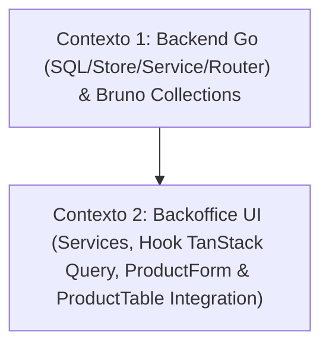

# 📐 Plano de Execução Técnica: Edição de Produto no Catálogo (Vertical Slicing)

Este plano técnico foi formulado pelo **Nexus Tech Planner** para implementar a funcionalidade completa de **edição/atualização de produto** (nome, descrição, preço e alteração opcional de imagem) no banco de dados via Raw SQL, expondo o endpoint administrativo na API REST em Go e integrando os fluxos e interfaces correspondentes no **Backoffice**, respeitando integralmente as regras de [`rules/RESTRICTIONS.md`](../../rules/RESTRICTIONS.md).

---

## 1. Visão Geral e Estratégia de Contextos

- **Resumo da Entrega:**
  1. **Banco de Dados & Storage (Go / Raw SQL):** Implementação de `UpdateProduct` no repositório PostgreSQL. Suporte a atualização dinâmica preservando a imagem original caso nenhum novo arquivo seja enviado no upload multipart, além de verificação de existência com retorno de `ErrProductNotFound` (`sql.ErrNoRows`).
  2. **API & Roteamento (Go / Gin):** Implementação do handler `HandleUpdateProduct`, validação de path param UUID (`/api/admin/products/:id`), validação de campos obrigatórios (`name`, `price > 0`, `description <= 500`), processamento condicional de arquivo de imagem (`multipart/form-data`) e respostas padronizadas (HTTP 200, 400, 404 e 500).
  3. **Bruno API Collection:** Criação das requisições de teste em `apps/backend/bruno/admin/` para cenários de atualização com sucesso, dados inválidos e produto não encontrado.
  4. **Frontend Backoffice (React 19 / Chakra UI v3 / TanStack Query):** Criação da função de serviço `updateAdminProduct`, hook de mutação `useUpdateAdminProduct` com invalidação de cache, evolução do `ProductForm` para suportar modo de edição (pré-preenchimento, imagem opcional e preview da imagem existente), adição do botão de edição com ícone `Pencil` na `ProductTable` e testes unitários Jest.
- **Nível de Complexidade:** **Média** (Vertical slice completo envolvendo Banco de Dados, Backend Go, Bruno Collections e UI React com formulário multimodal).
- **Quantidade de Contextos/Sessões:** **2 Contextos Isolados**.
- **Grafo de Dependência:**



---

## 2. Checklist Técnico Global (`[ ]`)

- [ ] **Camada de Banco de Dados & Storage Go (`apps/backend/postgres/`)**:
  - [ ] Adicionar método `UpdateProduct(ctx context.Context, p *Product) (*Product, error)` no contrato da interface `Storage` em `postgres/store.go`.
  - [ ] Implementar `UpdateProduct` em `postgres/products.go` usando Raw SQL:
    - Se `p.ImageURL != ""`: atualizar `name`, `description`, `price`, `image_url` e `updated_at = CURRENT_TIMESTAMP`.
    - Se `p.ImageURL == ""`: atualizar `name`, `description`, `price` e `updated_at = CURRENT_TIMESTAMP` preservando a imagem já existente.
  - [ ] Tratar `sql.ErrNoRows` convertendo para `ErrProductNotFound`.
- [ ] **Camada de Serviço & Handlers HTTP (`apps/backend/service/`)**:
  - [ ] Implementar `HandleUpdateProduct(c *gin.Context)` em `service/products.go`.
  - [ ] Validar path parameter `id` com `uuid.Parse(id)` retornando HTTP 400 em caso de formato inválido.
  - [ ] Validar campos obrigatórios do formulário multipart: `name` (não-vazio), `price` (número float > 0) e `description` (máximo de 500 caracteres).
  - [ ] Tratar campo de imagem: se `c.FormFile("image")` estiver presente, validar tipo/tamanho e salvar em `./uploads/`. Se não enviado, manter string vazia para preservar imagem atual no banco.
  - [ ] Tratar `ErrProductNotFound` respondendo HTTP 404 Not Found.
  - [ ] Retornar HTTP 200 OK com os dados do produto atualizado.
- [ ] **Roteamento & CORS (`apps/backend/routers/`)**:
  - [ ] Registrar a rota `admin.PUT("/products/:id", svc.HandleUpdateProduct)` em `routers/routers.go`.
- [ ] **Coleção de Testes no Bruno (`apps/backend/bruno/admin/`)**:
  - [ ] Criar requisição `Update Product.bru` com método `PUT` multipart/form-data e asserções de sucesso (`res.status: in [200, 404]`).
  - [ ] Criar requisição `Update Product - Not Found.bru` com asserções de erro 404 (`res.status: eq 404`).
- [ ] **Integração no Frontend Backoffice (`apps/frontend/backoffice/`)**:
  - [ ] Adicionar função `updateAdminProduct(id: string, formData: FormData): Promise<Product>` em `src/shared/services/products.ts`.
  - [ ] Criar hook `useUpdateAdminProduct` em `src/shared/hooks/useAdminProducts.ts` invalidando a query `['admin-products']`.
  - [ ] Evoluir `ProductForm`:
    - Receber prop opcional `initialProduct?: Product | null`.
    - Pré-preencher campos de texto e formatar preço inicial.
    - Exibir preview da imagem atual persistida (`initialProduct.imageUrl`).
    - Tornar o upload de imagem opcional na edição (obrigatório apenas na criação).
    - Alternar labels dos botões ("Salvar Alterações" vs "Criar Produto").
  - [ ] Atualizar `ProductTable` com botão de edição (`Pencil`), disparando callback `onEdit(product)`.
  - [ ] Integrar no container da página `src/pages/products/index.tsx`: gerenciar estado `editingProduct`, ajustar título do diálogo ("Editar Produto" vs "Cadastrar Novo Produto") e fechar diálogo após atualização bem-sucedida.
  - [ ] Atualizar testes unitários em `ProductForm` e `ProductTable`.

---

## 3. Prompts de Execução para Agentes (Ready-to-Run)

### Contexto 1: Banco de Dados, Handlers Go & Bruno Collection

```markdown
### AGENTE ALVO: backend-specialist

Você deve implementar a edição/atualização de produtos no Backend Go via Raw SQL e expor o endpoint REST administrativo `PUT /api/admin/products/:id`, acompanhado dos testes de API no Bruno.

#### Contexto & Diretrizes do Repositório
- Diretório de trabalho: `apps/backend/`.
- Regras Críticas:
  - Ler e respeitar estritamente `rules/RESTRICTIONS.md`.
  - Proibido o uso de ORMs (usar estritamente `database/sql` e Raw SQL com prepared statements e placeholders `$1`, `$2`, etc.).
  - Proibido idioma português no código (variáveis, mensagens de log, métodos e queries em inglês).
  - Obrigatoriedade de API Collection no Bruno (`apps/backend/bruno/admin/`).
  - Seguir a regra de single error handling: logar OU retornar, nunca ambos. Usar `slog` estruturado.
- Skills Obrigatórias a consultar:
  - `skills/backend/golang-database-repository/SKILL.md`
  - `skills/backend/golang-api-architecture/SKILL.md`
  - `skills/backend/golang-error-handling/SKILL.md`
  - `skills/backend/bruno-collection-generator/SKILL.md`
  - `skills/backend/bruno-test-writer/SKILL.md`

#### Instruções Técnicas Passo a Passo

1. **Repositório de Banco de Dados (`apps/backend/postgres/`)**:
   - Em `postgres/products.go`:
     - Implementar o método `UpdateProduct`:
       ```go
       func (s *Store) UpdateProduct(ctx context.Context, p *Product) (*Product, error) {
           var query string
           var row *sql.Row

           if p.ImageURL != "" {
               query = `
                   UPDATE products
                   SET name = $1, description = $2, price = $3, image_url = $4, updated_at = CURRENT_TIMESTAMP
                   WHERE id = $5
                   RETURNING id, name, description, price, image_url, created_at, updated_at
               `
               row = s.db.QueryRowContext(ctx, query, p.Name, p.Description, p.Price, p.ImageURL, p.ID)
           } else {
               query = `
                   UPDATE products
                   SET name = $1, description = $2, price = $3, updated_at = CURRENT_TIMESTAMP
                   WHERE id = $4
                   RETURNING id, name, description, price, image_url, created_at, updated_at
               `
               row = s.db.QueryRowContext(ctx, query, p.Name, p.Description, p.Price, p.ID)
           }

           var updated Product
           err := row.Scan(
               &updated.ID,
               &updated.Name,
               &updated.Description,
               &updated.Price,
               &updated.ImageURL,
               &updated.CreatedAt,
               &updated.UpdatedAt,
           )
           if err != nil {
               if errors.Is(err, sql.ErrNoRows) {
                   return nil, ErrProductNotFound
               }
               return nil, fmt.Errorf("failed to update product: %w", err)
           }

           return &updated, nil
       }
       ```
   - Em `postgres/store.go`:
     - Adicionar à interface `Storage`:
       `UpdateProduct(ctx context.Context, p *Product) (*Product, error)`

2. **Camada de Serviço HTTP (`apps/backend/service/`)**:
   - Em `service/products.go`:
     - Implementar o handler `HandleUpdateProduct(c *gin.Context)`:
       - Extrair e validar o ID:
         ```go
         id := strings.TrimSpace(c.Param("id"))
         if _, err := uuid.Parse(id); err != nil {
             s.HandleResponseError(c, "Invalid product ID format", err)
             return
         }
         ```
       - Validar `name`: não pode ser vazio (`"Product name is required"`).
       - Validar `price`: deve ser float positivo (`"Product price must be a valid positive number"`).
       - Validar `description`: não pode exceder 500 caracteres (`len([]rune(description)) > 500`).
       - Validar campo opcional `image`:
         - Chamar `fileHeader, err := c.FormFile("image")`.
         - Se `err == nil`: salvar imagem via `saveUploadedImage(c, fileHeader)` e preencher `imageURL`.
         - Se `err != nil`: `imageURL = ""` (manter a existente).
       - Montar struct `product := &postgres.Product{ ID: id, Name: name, Description: description, Price: price, ImageURL: imageURL }`.
       - Chamar `updated, err := s.store.UpdateProduct(c.Request.Context(), product)`.
       - Tratar `errors.Is(err, postgres.ErrProductNotFound)` retornando HTTP 404 Not Found:
         `c.JSON(http.StatusNotFound, Response{Message: "Product not found", Error: true})`.
       - Se outro erro, `s.HandleResponseError(c, "", err)`.
       - Responder sucesso com HTTP 200 OK:
         `s.HandleResponseAPIOK(c, updated, "Product updated successfully")`.

3. **Roteamento (`apps/backend/routers/routers.go`)**:
   - Dentro do grupo `admin := api.Group("/admin")`, registrar:
     `admin.PUT("/products/:id", svc.HandleUpdateProduct)`

4. **API Collection no Bruno (`apps/backend/bruno/admin/`)**:
   - Criar `apps/backend/bruno/admin/Update Product.bru`:
     - Método: `PUT`
     - URL: `{{baseUrl}}/api/admin/products/00000000-0000-0000-0000-000000000000`
     - Body `multipart/form-data`: `name`, `price`, `description`.
     - Assert: `res.status: in [200, 404]`
     - Docs explicando a atualização e a opcionalidade da imagem.
   - Criar `apps/backend/bruno/admin/Update Product - Not Found.bru`:
     - URL: `{{baseUrl}}/api/admin/products/a0000000-0000-0000-0000-000000000000`
     - Assert:
       - `res.status: eq 404`
       - `res.body.error: eq true`

#### Validação e Critérios de Sucesso
- Executar `go build ./...` no diretório `apps/backend` confirmando compilação limpa.
- Executar validações de endpoints no Bruno (`bru run apps/backend/bruno/admin`).
```

---

### Contexto 2: Interface Backoffice (Service, Hook TanStack Query, ProductForm & ProductTable Integration)

```markdown
### AGENTE ALVO: frontend-specialist

Você deve integrar a edição de produtos no Backoffice, adicionando o serviço de API, o hook de mutação TanStack Query, o botão de edição na tabela e a adaptação do formulário de produto para suportar criação e edição.

#### Contexto & Dependências
- O endpoint `PUT /api/admin/products/:id` já está implementado e validado no Backend Go.
- Diretório de trabalho: `apps/frontend/backoffice/`.
- Stack: React 19, Vite 8, Chakra UI v3, TailwindCSS + CSS Modules, Lucide React, TanStack Query v5 e Jest.
- Regras Críticas:
  - Respeitar `rules/RESTRICTIONS.md`.
  - Proibido colocar hooks em `services/` (manter funções Axios puras em `services/` e hooks em `hooks/`).
  - Código limpo em TypeScript, sem `any`, textos de interface em português brasileiro e código/variáveis em inglês.
- Skills Obrigatórias a consultar:
  - `skills/frontend/react/SKILL.md`
  - `skills/frontend/design/SKILL.md`
  - `skills/frontend/web-interface-guidelines/SKILL.md`

#### Instruções Técnicas Passo a Passo

1. **Serviço de Produtos (`apps/frontend/backoffice/src/shared/services/products.ts`)**:
   - Implementar a função `updateAdminProduct`:
     ```typescript
     export interface UpdateProductParams {
       id: string
       formData: FormData
     }

     /**
      * Updates an existing product on the backend API via multipart/form-data.
      *
      * @param params - Object containing product ID and FormData.
      * @returns Updated Product model.
      */
     export const updateAdminProduct = async ({ id, formData }: UpdateProductParams): Promise<Product> => {
       try {
         const response = await apiClient.put<ApiResponse<ApiProductPayload>>(`/api/admin/products/${id}`, formData)
         const apiResponse = response?.data
         const isSuccessful = Boolean(apiResponse?.success && apiResponse?.data)

         if (!isSuccessful) {
           const errorMessage = apiResponse?.message || 'Failed to update product'
           throw new Error(errorMessage)
         }

         return mapApiProductToProduct(apiResponse.data!)
       } catch (error: any) {
         const hasCustomMessage = Boolean(error?.response?.data?.message)
         if (hasCustomMessage) {
           throw new Error(error.response.data.message)
         }

         const isStandardError = error instanceof Error
         throw isStandardError ? error : new Error('Failed to update product')
       }
     }
     ```

2. **Hook de Mutação (`apps/frontend/backoffice/src/shared/hooks/useAdminProducts.ts`)**:
   - Implementar o hook `useUpdateAdminProduct`:
     ```typescript
     export const useUpdateAdminProduct = () => {
       const queryClient = useQueryClient()

       return useMutation({
         mutationFn: ({ id, formData }: { id: string; formData: FormData }) =>
           updateAdminProduct({ id, formData }),
         onSuccess: () => {
           queryClient.invalidateQueries({ queryKey: ['admin-products'] })
         },
       })
     }
     ```

3. **Adaptação do Formulário de Produto (`apps/frontend/backoffice/src/pages/products/components/ProductForm/index.tsx`)**:
   - Adicionar prop `initialProduct?: Product | null` em `ProductFormProps`.
   - Inicializar os estados com os valores de `initialProduct` quando fornecido:
     - `name`: `initialProduct ? initialProduct.name : ''`
     - `price`: `initialProduct ? formatCurrencyInput((initialProduct.price * 100).toFixed(0)) : ''`
     - `description`: `initialProduct ? initialProduct.description : ''`
     - `previewUrl`: `initialProduct?.imageUrl ? getProductImageUrl(initialProduct.imageUrl) : null`
   - Na validação do submit:
     - Se `initialProduct` estiver definido, o campo de imagem NÃO é obrigatório (o usuário só anexa se quiser substituir a imagem existente).
     - Se `selectedFile` estiver presente, anexa ao `formData.append('image', selectedFile)`.
   - Mutação:
     - Se `initialProduct` existir: invocar `updateProduct({ id: initialProduct.id, formData })`.
     - Se criação: invocar `createProduct(formData)`.
   - Botão de submit:
     - Texto dinâmico: `{isPending ? 'Salvando...' : initialProduct ? 'Salvar Alterações' : 'Criar Produto'}`.

4. **Botão de Edição na Tabela (`apps/frontend/backoffice/src/pages/products/components/ProductTable/index.tsx`)**:
   - Adicionar prop `onEdit?: (product: Product) => void` em `ProductTableProps`.
   - Na coluna de "Ações", adicionar botão de edição antes do botão de exclusão:
     - Ícone `Pencil` do `lucide-react`.
     - `aria-label="Editar produto <Nome>"`.
     - Estilo discreto de ação (`hover:text-amber-400 hover:bg-amber-500/10`).
     - Ao clicar, invocar `onEdit?.(product)`.

5. **Integração na Página de Produtos (`apps/frontend/backoffice/src/pages/products/index.tsx`)**:
   - Adicionar estado `editingProduct: Product | null`.
   - Ao clicar no botão "Adicionar Produto": definir `editingProduct = null` e `isDialogOpen = true`.
   - Ao clicar no botão de editar da tabela: definir `editingProduct = product` e `isDialogOpen = true`.
   - No `Dialog.Title`: `{editingProduct ? 'Editar Produto' : 'Cadastrar Novo Produto'}`.
   - Passar `initialProduct={editingProduct}` para o `ProductForm`.
   - Ao concluir com sucesso ou fechar modal: resetar `editingProduct` e fechar o diálogo.

6. **Testes Unitários**:
   - Atualizar `ProductForm/__tests__/index.test.tsx`:
     - Testar pré-carregamento dos campos no modo de edição.
     - Testar submissão com sucesso sem alterar imagem.
     - Testar submissão com alteração de imagem.
   - Atualizar `ProductTable/__tests__/index.test.tsx` verificando a chamada de `onEdit` ao clicar no botão de editar.

#### Validação e Critérios de Sucesso
- Executar `npm test` no diretório `apps/frontend/backoffice` garantindo 100% de aprovação.
- Executar `npm run build` garantindo zero erros de compilação TypeScript.
```
