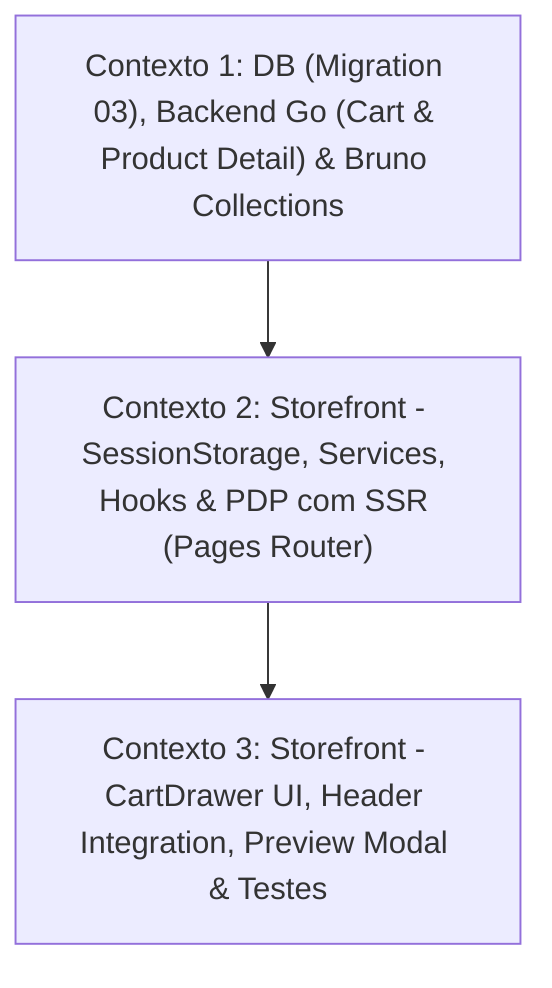

# 📐 Plano de Execução Técnica: Release 2 — Jornada de Compra (Carrinho Anônimo)

Este plano técnico foi formulado pelo **Nexus Tech Planner** com base nos requisitos da **Release 2** definidos em [`docs/ROADMAP.MD`](../../docs/ROADMAP.MD), atendendo integralmente à decisão arquitetural de **armazenamento temporário de `sessionId` em `sessionStorage`** no cliente, com o fatiamento vertical e as restrições estritas de [`rules/RESTRICTIONS.md`](../../rules/RESTRICTIONS.md).

---

## 1. Visão Geral e Estratégia de Contextos

- **Resumo da Entrega:**
  1. **Banco de Dados & Storage (Go / PostgreSQL / Raw SQL):** Migration `03-create-carts.sql` criando as tabelas `carts` (chaveada por `session_id VARCHAR(255) UNIQUE`) e `cart_items` com integridade referencial em cascata e constraint única `(cart_id, product_id)` para suporte atômico a upsert/incremento. Repositório Go com cálculo de subtotal dinâmico via SQL (`SUM(ci.quantity * p.price)`).
  2. **API Go / Gin & Bruno:** Criação de endpoints públicos de catálogo individual (`GET /api/store/products/:id`) e de carrinho sob `/api/store/cart` (`GET`, `POST /items`, `PATCH /items/:id`, `DELETE /items/:id`) via header `X-Session-ID`, inclusão de `X-Session-ID` no CORS e suite de testes declarativos no Bruno (`apps/backend/bruno/store/`).
  3. **Gestão de Sessão & Client-side:** Utilitário `getOrCreateSessionId()` gerenciando UUID persistido em `sessionStorage` no Storefront, interceptor Axios para injeção automática do cabeçalho `X-Session-ID`, serviços e hooks do TanStack Query (`useCart`, `useAddToCart`, `useUpdateCartItem`, `useRemoveCartItem`).
  4. **Página de Detalhes do Produto (PDP):** Rota `src/pages/product/[id].tsx` com pré-renderização SSR obrigatória via `getServerSideProps` repassando `initialData` ao hook de produto (sem waterfalls e em conformidade estrita com `rules/RESTRICTIONS.md`), seletor de quantidade e adição ao carrinho.
  5. **Interface do Carrinho (Cart Drawer):** Drawer lateral moderno, acessível e responsivo, exibição de itens, botões incrementais (`+` / `-`), remoção com confirmação/feedback, subtotal atualizado em tempo real, sincronização com o badge do `Header` e habilitação do botão de compra no `ProductPreviewModal`.
- **Nível de Complexidade:** **Complexa** (Envolve modelagem relacional, migrations SQL, múltiplos endpoints REST, SSR no Next.js Pages Router, gerenciamento de estado anônimo em `sessionStorage` e interface interativa com Drawer).
- **Quantidade de Contextos/Sessões:** **3 Contextos Isolados**.
- **Grafo de Dependência:**



---

## 2. Checklist Técnico Global (`[ ]`)

- [ ] **Banco de Dados & Migrações (`apps/backend/migrations/`)**:
  - [ ] Criar arquivo versionado `03-create-carts.sql` com tabelas `carts` e `cart_items`, índices e foreign keys com `ON DELETE CASCADE`.
- [ ] **Camada de Repositório Go (`apps/backend/postgres/`)**:
  - [ ] Implementar `GetProductByID(ctx context.Context, id string) (*Product, error)` em `postgres/products.go`.
  - [ ] Criar `postgres/carts.go` com structs `Cart` e `CartItem` e métodos: `GetOrCreateCartBySessionID`, `GetCartBySessionID`, `AddItemToCart`, `UpdateCartItemQuantity` e `RemoveCartItem`.
  - [ ] Atualizar contrato `Storage` em `postgres/store.go`.
- [ ] **Serviço HTTP & Rotas REST (`apps/backend/service/` e `apps/backend/routers/`)**:
  - [ ] Adicionar `X-Session-ID` na lista `Access-Control-Allow-Headers` em `routers/routers.go`.
  - [ ] Implementar `HandleGetProduct(c *gin.Context)` em `service/products.go`.
  - [ ] Criar `service/cart.go` com handlers: `HandleGetCart`, `HandleAddCartItem`, `HandleUpdateCartItem` e `HandleRemoveCartItem`.
  - [ ] Registrar rotas públicas em `routers/routers.go`: `GET /api/store/products/:id`, `GET /api/store/cart`, `POST /api/store/cart/items`, `PATCH /api/store/cart/items/:id` e `DELETE /api/store/cart/items/:id`.
- [ ] **API Collection no Bruno (`apps/backend/bruno/store/`)**:
  - [ ] Criar requisições em `apps/backend/bruno/store/`: `Get Product.bru`, `Get Cart.bru`, `Add Item to Cart.bru`, `Update Cart Item.bru` e `Delete Cart Item.bru`.
- [ ] **Storefront: Sessão, Serviços e Hooks (`apps/frontend/storefront/src/shared/`)**:
  - [ ] Criar utilitário `src/shared/utils/session.ts` com gerenciamento de `sessionId` em `sessionStorage`.
  - [ ] Configurar interceptor Axios em `src/shared/services/api.ts` para enviar cabeçalho `X-Session-ID`.
  - [ ] Adicionar `fetchProductById` em `src/shared/services/catalog.ts`.
  - [ ] Criar `src/shared/services/cart.ts` com endpoints da API de carrinho.
  - [ ] Criar hooks TanStack Query em `src/shared/hooks/useCart.ts` (`useCart`, `useAddToCart`, `useUpdateCartItem`, `useRemoveCartItem`).
- [ ] **Storefront: Página de Detalhes do Produto (PDP) (`apps/frontend/storefront/src/pages/product/`)**:
  - [ ] Criar página `src/pages/product/[id].tsx` com `getServerSideProps` e `initialData`.
  - [ ] Renderizar galeria/imagem ampliada, detalhes do produto, seletor de quantidade (1 a 10) e botão de adicionar ao carrinho.
- [ ] **Storefront: CartDrawer & Interatividade Global (`apps/frontend/storefront/src/shared/components/`)**:
  - [ ] Implementar componente `CartDrawer` com backdrop, lista de itens, controles de quantidade, exclusão de itens e subtotal.
  - [ ] Integrar abertura do carrinho e badge de contagem de itens em tempo real no `Header`.
  - [ ] Habilitar botão "Adicionar ao Carrinho" no modal `ProductPreviewModal`.
  - [ ] Adicionar testes unitários Jest cobrindo o fluxo de carrinho e interações.

---

## 3. Prompts de Execução para Agentes (Ready-to-Run)

### Contexto 1: DB (Migration 03), Backend Go (Cart & Product Detail) & Bruno Collections

```markdown
### AGENTE ALVO: backend-specialist

Você deve implementar a modelagem e endpoints da Release 2 no Backend Go (Migration SQL, Repositório com Raw SQL, Handlers HTTP e Bruno Collections), respeitando o gerenciamento de carrinho anônimo via header `X-Session-ID`.

#### Contexto & Diretrizes do Repositório
- Diretório de trabalho: `apps/backend/`.
- Regras Críticas:
  - Ler e respeitar estritamente `rules/RESTRICTIONS.md`.
  - Proibido o uso de ORMs (usar estritamente `database/sql` e Raw SQL com placeholders `$1`, `$2`, etc.).
  - Proibido idioma português no código (tudo em inglês).
  - Obrigatoriedade de API Collection no Bruno (`apps/backend/bruno/store/`).
  - Seguir a regra de single error handling: logar OU retornar, nunca ambos. Usar `slog` estruturado.
- Skills Obrigatórias a consultar:
  - `skills/backend/golang-database-repository/SKILL.md`
  - `skills/backend/golang-api-architecture/SKILL.md`
  - `skills/backend/golang-error-handling/SKILL.md`
  - `skills/backend/bruno-collection-generator/SKILL.md`
  - `skills/backend/bruno-test-writer/SKILL.md`

#### Instruções Técnicas Passo a Passo

1. **Migration SQL (`apps/backend/migrations/03-create-carts.sql`)**:
   - Criar arquivo:
     ```sql
     -- Migration: 03-create-carts.sql
     -- Anonymous cart and cart items for Release 2

     CREATE TABLE IF NOT EXISTS carts (
         id UUID PRIMARY KEY DEFAULT gen_random_uuid(),
         session_id VARCHAR(255) NOT NULL UNIQUE,
         created_at TIMESTAMP WITH TIME ZONE DEFAULT CURRENT_TIMESTAMP,
         updated_at TIMESTAMP WITH TIME ZONE DEFAULT CURRENT_TIMESTAMP
     );

     CREATE TABLE IF NOT EXISTS cart_items (
         id UUID PRIMARY KEY DEFAULT gen_random_uuid(),
         cart_id UUID NOT NULL REFERENCES carts(id) ON DELETE CASCADE,
         product_id UUID NOT NULL REFERENCES products(id) ON DELETE CASCADE,
         quantity INTEGER NOT NULL CHECK (quantity > 0),
         created_at TIMESTAMP WITH TIME ZONE DEFAULT CURRENT_TIMESTAMP,
         updated_at TIMESTAMP WITH TIME ZONE DEFAULT CURRENT_TIMESTAMP,
         CONSTRAINT unique_cart_product UNIQUE (cart_id, product_id)
     );

     CREATE INDEX IF NOT EXISTS idx_carts_session_id ON carts(session_id);
     CREATE INDEX IF NOT EXISTS idx_cart_items_cart_id ON cart_items(cart_id);
     ```

2. **Repositório de Banco de Dados (`apps/backend/postgres/`)**:
   - Em `postgres/products.go`:
     - Implementar `GetProductByID(ctx context.Context, id string) (*Product, error)` usando `SELECT id, name, description, price, image_url, created_at, updated_at FROM products WHERE id = $1`. Retornar `ErrProductNotFound` se `sql.ErrNoRows`.
   - Criar `postgres/carts.go`:
     - Definir structs:
       ```go
       type CartItem struct {
           ID        string    `json:"id"`
           CartID    string    `json:"cart_id"`
           ProductID string    `json:"product_id"`
           Quantity  int       `json:"quantity"`
           Product   Product   `json:"product"`
           Subtotal  float64   `json:"subtotal"`
           CreatedAt time.Time `json:"created_at"`
           UpdatedAt time.Time `json:"updated_at"`
       }

       type Cart struct {
           ID        string     `json:"id"`
           SessionID string     `json:"session_id"`
           Items     []CartItem `json:"items"`
           Subtotal  float64    `json:"subtotal"`
           CreatedAt time.Time  `json:"created_at"`
           UpdatedAt time.Time  `json:"updated_at"`
       }
       ```
     - Implementar métodos:
       - `GetOrCreateCartBySessionID(ctx context.Context, sessionID string) (*Cart, error)`: insere `INSERT INTO carts (session_id) VALUES ($1) ON CONFLICT (session_id) DO NOTHING` e depois busca o carrinho completo com seus itens e produtos vinculados através de `LEFT JOIN`.
       - `GetCartBySessionID(ctx context.Context, sessionID string) (*Cart, error)`: busca carrinho pelo `sessionID`, calculando `item.Subtotal = float64(quantity) * product.Price` e `cart.Subtotal = soma dos subtotais`. Se não existir, retorna um carrinho vazio com a `sessionID` informada.
       - `AddItemToCart(ctx context.Context, sessionID string, productID string, quantity int) (*Cart, error)`:
         - Garante existência do carrinho.
         - Faz UPSERT atômico em `cart_items`:
           ```sql
           INSERT INTO cart_items (cart_id, product_id, quantity)
           VALUES ($1, $2, $3)
           ON CONFLICT (cart_id, product_id)
           DO UPDATE SET quantity = cart_items.quantity + EXCLUDED.quantity, updated_at = CURRENT_TIMESTAMP
           ```
         - Retorna o carrinho atualizado via `GetCartBySessionID`.
       - `UpdateCartItemQuantity(ctx context.Context, sessionID string, itemID string, quantity int) (*Cart, error)`:
         - Se `quantity <= 0`, executa remoção do item.
         - Se `quantity > 0`, atualiza a quantidade do item garantindo que pertença ao carrinho daquela `sessionID`.
         - Retorna o carrinho atualizado.
       - `RemoveCartItem(ctx context.Context, sessionID string, itemID string) (*Cart, error)`:
         - Remove o item com `DELETE FROM cart_items WHERE id = $1 AND cart_id = (SELECT id FROM carts WHERE session_id = $2)`.
         - Retorna o carrinho atualizado.
   - Em `postgres/store.go`:
     - Registrar todos os novos métodos na interface `Storage`.

3. **Camada de Serviço HTTP (`apps/backend/service/`)**:
   - Em `service/products.go`:
     - Implementar `HandleGetProduct(c *gin.Context)`:
       - Extrai `id := c.Param("id")`, valida UUID.
       - Busca via `s.store.GetProductByID`.
       - Retorna 404 se não encontrado ou 200 OK com o produto.
   - Criar `service/cart.go`:
     - Helper `getSessionID(c *gin.Context) string`: extrai do header `X-Session-ID` ou query `session_id`. Se vazio, retorna HTTP 400 (`"Session ID is required"`).
     - `HandleGetCart(c *gin.Context)`: chama `s.store.GetCartBySessionID`.
     - `HandleAddCartItem(c *gin.Context)`: faz bind JSON `{ "product_id": string, "quantity": int }`. Valida `product_id` (UUID) e `quantity > 0` (default 1). Chama `AddItemToCart`.
     - `HandleUpdateCartItem(c *gin.Context)`: extrai `itemID := c.Param("id")`, faz bind `{ "quantity": int }`. Valida `quantity > 0`. Chama `UpdateCartItemQuantity`.
     - `HandleRemoveCartItem(c *gin.Context)`: extrai `itemID := c.Param("id")`. Chama `RemoveCartItem`.

4. **Roteamento & CORS (`apps/backend/routers/routers.go`)**:
   - Em `corsMiddleware`, adicionar `X-Session-ID` aos headers permitidos em `Access-Control-Allow-Headers`.
   - Adicionar em `store := api.Group("/store")`:
     ```go
     store.GET("/products/:id", svc.HandleGetProduct)
     store.GET("/cart", svc.HandleGetCart)
     store.POST("/cart/items", svc.HandleAddCartItem)
     store.PATCH("/cart/items/:id", svc.HandleUpdateCartItem)
     store.DELETE("/cart/items/:id", svc.HandleRemoveCartItem)
     ```

5. **Bruno API Collection (`apps/backend/bruno/store/`)**:
   - Criar pasta `apps/backend/bruno/store/cart/` com os arquivos:
     - `Get Cart.bru` (`GET {{baseUrl}}/api/store/cart` com header `X-Session-ID: test-session-123`).
     - `Add Cart Item.bru` (`POST {{baseUrl}}/api/store/cart/items` com body JSON).
     - `Update Cart Item.bru` (`PATCH {{baseUrl}}/api/store/cart/items/{{itemId}}`).
     - `Remove Cart Item.bru` (`DELETE {{baseUrl}}/api/store/cart/items/{{itemId}}`).
   - Criar `apps/backend/bruno/store/Get Product.bru` (`GET {{baseUrl}}/api/store/products/{{productId}}`).

#### Validação e Critérios de Sucesso
- Executar `go build ./...` no diretório `apps/backend` confirmando ausência de erros.
- Executar a migração via container ou scripts de migração.
- Testar requisições no Bruno validando as respostas HTTP 200/201.
```

---

### Contexto 2: Storefront - SessionStorage, Services, Hooks & PDP com SSR (Pages Router)

```markdown
### AGENTE ALVO: frontend-specialist

Você deve configurar a infraestrutura de sessão anônima em `sessionStorage`, a camada de serviços/hooks de API do carrinho e implementar a Página de Detalhes do Produto (PDP) com SSR no Storefront.

#### Contexto & Dependências
- Backend com endpoints `/api/store/cart` e `/api/store/products/:id` já disponível.
- Diretório de trabalho: `apps/frontend/storefront/`.
- Stack: Next.js 16 (Pages Router), React 19, TailwindCSS, Axios, TanStack Query v5 e Jest.
- Regras Críticas:
  - Respeitar estritamente `rules/RESTRICTIONS.md`.
  - Padrão SSR Obrigatório com `initialData`: a PDP (`src/pages/product/[id].tsx`) DEVE buscar os dados em `getServerSideProps` e repassar em `props.product` para alimentar o hook do React Query via `initialData`.
  - Proibido misturar hooks dentro de `services/` (manter funções Axios em `src/shared/services/` e hooks em `src/shared/hooks/`).
  - Código limpo, tipado e sem textos em português em variáveis/métodos.
- Skills Obrigatórias a consultar:
  - `skills/frontend/architecture-agent/SKILL.md`
  - `skills/frontend/react/SKILL.md`
  - `skills/frontend/web-interface-guidelines/SKILL.md`
  - `rules/RESTRICTIONS.md`

#### Instruções Técnicas Passo a Passo

1. **Gerenciamento de Sessão (`src/shared/utils/session.ts`)**:
   - Implementar:
     ```typescript
     const SESSION_STORAGE_KEY = 'nexus_store_session_id'

     export const getSessionId = (): string | null => {
       if (typeof window === 'undefined') return null
       try {
         return sessionStorage.getItem(SESSION_STORAGE_KEY)
       } catch {
         return null
       }
     }

     export const getOrCreateSessionId = (): string => {
       if (typeof window === 'undefined') return ''
       try {
         let sessionId = sessionStorage.getItem(SESSION_STORAGE_KEY)
         if (!sessionId) {
           sessionId = typeof crypto.randomUUID === 'function'
             ? crypto.randomUUID()
             : `sess_${Date.now()}_${Math.random().toString(36).substring(2, 9)}`
           sessionStorage.setItem(SESSION_STORAGE_KEY, sessionId)
         }
         return sessionId
       } catch {
         return ''
       }
     }
     ```

2. **Interceptor da API (`src/shared/services/api.ts` ou client Axios)**:
   - Adicionar interceptor para anexar automaticamente o header `X-Session-ID`:
     ```typescript
     apiClient.interceptors.request.use((config) => {
       const sessionId = getOrCreateSessionId()
       if (sessionId) {
         config.headers.set('X-Session-ID', sessionId)
       }
       return config
     })
     ```

3. **Serviços de API (`src/shared/services/`)**:
   - Em `services/catalog.ts`:
     - Implementar `fetchProductById(id: string): Promise<Product>`.
   - Criar `services/cart.ts`:
     - Tipos: `CartItem`, `Cart`, `AddToCartPayload { productId: string; quantity?: number }`.
     - Funções:
       - `fetchCart(): Promise<Cart>`
       - `addToCart(payload: AddToCartPayload): Promise<Cart>`
       - `updateCartItemQuantity(itemId: string, quantity: number): Promise<Cart>`
       - `removeCartItem(itemId: string): Promise<Cart>`

4. **Hooks TanStack Query (`src/shared/hooks/`)**:
   - Em `hooks/useProductDetail.ts`:
     - Criar hook `useProductDetail(id: string, initialData?: Product)` consumindo `fetchProductById` com `initialData`.
   - Criar `hooks/useCart.ts`:
     - Exportar:
       - `useCart()` com `queryKey: ['store-cart']`
       - `useAddToCart()` com `onSuccess: () => queryClient.invalidateQueries({ queryKey: ['store-cart'] })`
       - `useUpdateCartItem()`
       - `useRemoveCartItem()`

5. **Página de Detalhes do Produto (PDP) (`src/pages/product/[id].tsx`)**:
   - Implementar com Next.js Pages Router:
     - `export const getServerSideProps: GetServerSideProps = async (context) => { ... }`:
       - Extrai `id = context.params?.id as string`.
       - Chama `fetchProductById(id)`. Se não encontrar, retorna `{ notFound: true }`.
       - Retorna `{ props: { initialProduct: product } }`.
     - Componente da Página:
       - Consome `const { data: product } = useProductDetail(initialProduct.id, initialProduct)`.
       - Renderiza `Layout` com título dinâmico.
       - Estrutura responsiva com 2 colunas no desktop:
         - Coluna 1: Imagem ampliada em destaque com fallback elegante.
         - Coluna 2: Breadcrumb de navegação, nome do produto, preço com formatação em Real, badge "Em Estoque", descrição completa, seletor interativo de quantidade (botões `-` / `+` limitados entre 1 e 10) e botão primário "Adicionar ao Carrinho".
       - Ao clicar em "Adicionar ao Carrinho": dispara `useAddToCart`, exibe estado de loading e feedback de sucesso.

#### Validação e Critérios de Sucesso
- Acessar `/product/[id]` e confirmar que o HTML gerado via SSR já contém os dados do produto (sem telas brancas nem loaders iniciais).
- Verificar que ao adicionar o produto, a requisição envia o header `X-Session-ID` e o valor persiste no `sessionStorage`.
```

---

### Contexto 3: Storefront - CartDrawer UI, Header Integration, Preview Modal & Testes

```markdown
### AGENTE ALVO: frontend-specialist

Você deve criar o componente `CartDrawer` no Storefront, integrá-lo com o `Header` e com o `ProductPreviewModal`, fornecendo a experiência completa de visualização, edição de quantidades e remoção de itens do carrinho.

#### Contexto & Dependências
- Contexto 2 concluído: `useCart`, `useAddToCart`, `useUpdateCartItem`, `useRemoveCartItem` e `sessionStorage` operacionais.
- Diretório de trabalho: `apps/frontend/storefront/`.
- Stack: React 19, Next.js Pages Router, TailwindCSS + CSS Modules, Lucide React e Jest.
- Regras Críticas:
  - Respeitar `rules/RESTRICTIONS.md`.
  - Design premium alinhado à estética dark/modern do Nexus Storefront.
  - Acessibilidade: fechar com tecla `Escape`, clique no backdrop, foco adequado e labels ARIA.
- Skills Obrigatórias a consultar:
  - `skills/frontend/design/SKILL.md`
  - `skills/frontend/web-interface-guidelines/SKILL.md`
  - `skills/frontend/react/SKILL.md`

#### Instruções Técnicas Passo a Passo

1. **Componente `CartDrawer` (`src/shared/components/CartDrawer/`)**:
   - Criar `CartDrawer/index.tsx` e `styles.module.css`:
     - Props: `isOpen: boolean`, `onClose: () => void`.
     - Estrutura:
       - Backdrop com blur suave e transição de opacidade.
       - Painel lateral deslizando pela direita (`width: 100%`, max 420px).
       - Cabeçalho: título "Seu Carrinho", contador de itens e botão de fechar com ícone `X`.
       - Corpo do Carrinho:
         - **Estado Vazio**: ilustrado com ícone `ShoppingBag`, mensagem "Seu carrinho está vazio" e botão "Explorar Produtos" que fecha o drawer e direciona para a vitrine.
         - **Lista de Itens**: para cada item do carrinho:
           - Miniatura da imagem com `alt` descritivo.
           - Nome do produto e preço unitário.
           - Controle de quantidade: botões `-` e `+` acionando `useUpdateCartItem` (se diminuir de 1, chama remoção ou confirma).
           - Botão de exclusão rápida com ícone `Trash2` acionando `useRemoveCartItem`.
           - Subtotal do item formatado em Real (`R$`).
       - Rodapé fixo:
         - Linha de Subtotal em destaque com o valor total calculado pelo backend.
         - Mensagem informativa sobre frete/checkout.
         - Botão primário "Finalizar Compra" (ou "Prosseguir para o Checkout").
         - Botão secundário "Continuar Comprando".

2. **Integração no `Header` (`src/shared/components/Header/index.tsx`)**:
   - Conectar o botão do carrinho no Header ao hook `useCart`:
     - Exibir no badge a soma total de itens (`cart.items.reduce((acc, item) => acc + item.quantity, 0)`).
     - Ao clicar no botão, disparar abertura do `CartDrawer`.

3. **Integração no `Layout` (`src/shared/components/Layout/index.tsx`)**:
   - Gerenciar o estado global de abertura do carrinho (`isCartOpen`) ou disponibilizar via Contexto simples (`CartUIContext`).
   - Renderizar o `CartDrawer` no `Layout` para estar disponível em todas as páginas da aplicação.

4. **Habilitação no `ProductPreviewModal` (`src/shared/components/ProductPreviewModal/index.tsx`)**:
   - Remover o atributo `disabled` e o aviso "Disponível na Release 2" do botão "Adicionar ao Carrinho".
   - Integrar com o hook `useAddToCart`.
   - Ao adicionar o produto com sucesso, fechar o modal de prévia e abrir automaticamente o `CartDrawer`.

5. **Testes Unitários Jest (`src/shared/components/CartDrawer/__tests__/index.test.tsx` e `Header/__tests__/`)**:
   - Cobrir os cenários:
     - Renderização do drawer aberto e fechado.
     - Exibição de estado vazio quando não há itens.
     - Renderização dos itens com quantidades e valores corretos.
     - Disparo da atualização de quantidade e remoção de item.
     - Fechamento com tecla Escape e clique no backdrop.

#### Validação e Critérios de Sucesso
- Executar `npm test` no storefront validando 100% dos testes sem falhas.
- Executar `npm run build` garantindo build Next.js com sucesso.
```
