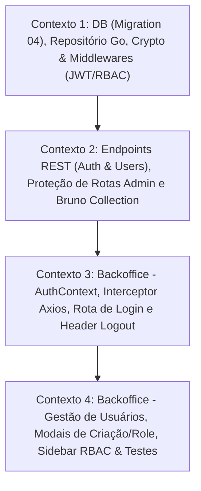

# 📐 Plano de Execução Técnica: Release 3 — Gestão de Identidade e Controle de Acesso (RBAC)

Este plano técnico foi formulado pelo **Nexus Tech Planner** com base nos requisitos da **Release 3** definidos em [`docs/ROADMAP.MD`](../../docs/ROADMAP.MD), atendendo integralmente à modelagem de roles (`admin`, `manager`, `user`), autenticação JWT, proteção de rotas administrativas e controle de acesso condicional no Backoffice, em conformidade com as restrições estritas de [`rules/RESTRICTIONS.md`](../../rules/RESTRICTIONS.md).

---

## 1. Visão Geral e Estratégia de Contextos

- **Resumo da Entrega:**
  1. **Banco de Dados & Storage (Go / PostgreSQL / Raw SQL):** Migration versionada `04-create-backoffice-users.sql` criando a tabela `backoffice_users` (`id UUID`, `name`, `email UNIQUE`, `password_hash`, `role CHECK (role IN ('admin', 'manager', 'user'))`, `created_at`) e inserção do usuário `admin` root com credenciais de desenvolvimento padrão (`admin@nexuscommerce.com` / `admin123`). Repositório Go com métodos de busca por email/id, listagem ordenada e atualização atômica de role.
  2. **Criptografia, JWT & Middlewares (Go):** Expansão de `utils/crypto.go` com geração/validação de tokens JWT (usando `golang-jwt/jwt/v5`), middleware de autenticação JWT injetando `user_id`, `email` e `role` no contexto do Gin, e middleware RBAC assegurando hierarquia de acesso (`admin` > `manager` > `user`).
  3. **Endpoints REST da Nexus API & Bruno Collections:** Endpoints públicos de login (`POST /api/admin/auth/login`) e endpoints autenticados/protegidos de usuários (`GET /api/admin/users`, `POST /api/admin/users`, `PATCH /api/admin/users/:id/role`). Atualização da proteção de todas as rotas de produtos do backoffice. Criação de requisições e asserts automatizados no Bruno (`apps/backend/bruno/admin/`).
  4. **Backoffice: Autenticação & Proteção de Rotas:** Implementação do `AuthContext`, interceptor do Axios para injeção do `Bearer <token>` e tratamento automático de 401, tela de Login moderna e responsiva (Chakra UI v3), guarda global de rotas no `App.tsx` e atualização do `Header` com dados do usuário logado e botão de Logout.
  5. **Backoffice: Gestão de Usuários & RBAC UI:** Interface de usuários com TanStack Query, tabela de listagem com badges de role, modal de criação de usuário com roles condicionadas (`manager` só pode criar `user`; `admin` pode criar qualquer role), modal/ação para alteração de role restrito a `admin`, e ocultação condicional de menus no `Sidebar` para o perfil `user`.
- **Nível de Complexidade:** **Complexa** (Criptografia com bcrypt, tokens JWT, middlewares de autenticação/RBAC no Gin, proteção transversal de rotas legadas, controle de estado de autenticação no client-side e interfaces administrativas com permissões condicionais).
- **Quantidade de Contextos/Sessões:** **4 Contextos Isolados**.
- **Grafo de Dependência:**



---

## 2. Checklist Técnico Global (`[x]`)

- [x] **Banco de Dados & Migrações (`apps/backend/migrations/`)**:
  - [x] Criar arquivo versionado `04-create-backoffice-users.sql` criando `backoffice_users` com checagem de roles (`admin`, `manager`, `user`) e seed do root `admin@nexuscommerce.com`.
- [x] **Configuração & Criptografia (`apps/backend/config/` e `apps/backend/utils/`)**:
  - [x] Adicionar suporte a `JWTConfig` (`secret`, `expiration_hours`) em `config/environments.go` e `config.toml`.
  - [x] Instalar `github.com/golang-jwt/jwt/v5` no `go.mod`.
  - [x] Implementar funções `GenerateJWT` e `ValidateJWT` em `utils/crypto.go`.
- [x] **Repositório Go (`apps/backend/postgres/`)**:
  - [x] Criar `postgres/users.go` com struct `BackofficeUser` e métodos: `CreateBackofficeUser`, `GetBackofficeUserByEmail`, `GetBackofficeUserByID`, `ListBackofficeUsers` e `UpdateBackofficeUserRole`.
  - [x] Atualizar interface `Storage` em `postgres/store.go`.
- [x] **Middlewares & Serviços HTTP (`apps/backend/service/` e `apps/backend/routers/`)**:
  - [x] Criar middleware JWT `RequireAuth` e middleware RBAC `RequireRole` em `service/auth_middleware.go`.
  - [x] Criar `service/auth.go` com `HandleAdminLogin`.
  - [x] Criar `service/users.go` com `HandleListBackofficeUsers`, `HandleCreateBackofficeUser` e `HandleUpdateBackofficeUserRole`.
  - [x] Atualizar `routers/routers.go` protegendo rotas `/api/admin/*` com autenticação e RBAC, mantendo `/api/admin/auth/login` pública.
- [x] **API Collection no Bruno (`apps/backend/bruno/admin/`)**:
  - [x] Criar pasta `apps/backend/bruno/admin/auth/` com `Login.bru` (com script pós-resposta para salvar `adminToken`).
  - [x] Criar pasta `apps/backend/bruno/admin/users/` com requisições: `List Users.bru`, `Create User - Admin.bru`, `Create User - Manager Forbidden.bru`, `Update User Role.bru`.
  - [x] Atualizar requests existentes de `admin/` com header `Authorization: Bearer {{adminToken}}`.
- [x] **Backoffice: Autenticação & Sessão (`apps/frontend/backoffice/src/`)**:
  - [x] Criar `src/shared/services/auth.ts` com tipagens e chamadas `loginAdmin` e `getStoredAuth`.
  - [x] Configurar interceptor no Axios em `src/shared/services/api.ts` para injetar `Authorization: Bearer <token>` e tratar 401.
  - [x] Criar `src/shared/context/AuthContext.tsx` e hook `useAuth()`.
  - [x] Criar página de login em `src/pages/login/` com feedback de erro e visual Chakra UI v3.
  - [x] Integrar guarda de rotas no `src/app.tsx` redirecionando usuários não autenticados para `/login`.
  - [x] Atualizar `Header` exibindo nome, badge de role do usuário logado e botão de Logout.
- [x] **Backoffice: Gestão de Usuários & RBAC UI (`apps/frontend/backoffice/src/`)**:
  - [x] Criar `src/shared/services/users.ts` e hook `src/shared/hooks/useAdminUsers.ts`.
  - [x] Atualizar `src/shared/components/Sidebar` para esconder item "Usuários" para `role === 'user'`.
  - [x] Proteger rota `/users` exibindo mensagem de restrição 403 se acessada diretamente por `user`.
  - [x] Atualizar `src/pages/users/index.tsx` conectando na API real com estados de loading, empty e erro.
  - [x] Implementar modal de criação de usuário respeitando regras de privilégio (`manager` só pode criar `user`).
  - [x] Implementar ação/modal de alteração de role restrita a `admin`.
  - [x] Implementar testes unitários Jest cobrindo regras de permissão e autenticação.

---

## 3. Prompts de Execução para Agentes (Ready-to-Run)

### Contexto 1: DB (Migration 04), Repositório Go, Crypto & Middlewares (JWT/RBAC)

```markdown
### AGENTE ALVO: backend-specialist

Você deve implementar a base de dados, infraestrutura de criptografia/JWT e camada de repositório Go para a **Release 3: Gestão de Identidade e Controle de Acesso (RBAC)** do Nexus Commerce.

#### 1. Contexto & Dependências
- Monorepo com backend Go em `apps/backend/`.
- O banco PostgreSQL roda via Podman (`apps/backend/compose.yml`).
- As migrations existentes são `01-initial-setup.sql`, `02-create-products.sql` e `03-create-carts.sql`.
- A próxima migration obrigatória é `04-create-backoffice-users.sql`.
- Consulte e respeite estritamente:
  - `rules/RESTRICTIONS.md` (Raw SQL sem ORM, nomes em inglês, imutabilidade das migrations anteriores).
  - `skills/backend/golang-database-repository/SKILL.md`
  - `skills/backend/golang-api-architecture/SKILL.md`
  - `skills/backend/golang-code-style/SKILL.md`

#### 2. Instruções Técnicas

1. **Migration SQL versionada (`apps/backend/migrations/04-create-backoffice-users.sql`):**
   - Crie a tabela `backoffice_users`:
     - `id UUID PRIMARY KEY DEFAULT gen_random_uuid()`
     - `name VARCHAR(255) NOT NULL`
     - `email VARCHAR(255) NOT NULL UNIQUE`
     - `password_hash VARCHAR(255) NOT NULL`
     - `role VARCHAR(50) NOT NULL CHECK (role IN ('admin', 'manager', 'user'))`
     - `created_at TIMESTAMP WITH TIME ZONE DEFAULT CURRENT_TIMESTAMP`
   - Crie índice em `email`: `CREATE INDEX IF NOT EXISTS idx_backoffice_users_email ON backoffice_users(email);`.
   - Adicione o seed inicial do admin root:
     - `name`: `'Nexus Admin'`
     - `email`: `'admin@nexuscommerce.com'`
     - `password_hash`: Hash bcrypt de `'admin123'` (custo padrão 10, ex: `'$2a$10$vI8aWBnW3fID.ZQ4/zo1G.q1lR5ePqgXhXfW4qj6kE9vDk1l9jWCe'` ou gerado equivalentemente via Go).
     - `role`: `'admin'`

2. **Configuração JWT (`apps/backend/config/environments.go` e `apps/backend/config.toml`):**
   - Atualize `config.toml` adicionando a seção `[jwt]`:
     ```toml
     [jwt]
     secret = "nexus-commerce-super-secret-jwt-key-2026"
     expiration_hours = 24
     ```
   - Atualize `environments.go` com a struct `JWTConfig` (`Secret string`, `ExpirationHours int`) e inclua em `AppConfig`.

3. **Criptografia e Validação de Tokens (`apps/backend/utils/crypto.go`):**
   - Adicione a biblioteca `github.com/golang-jwt/jwt/v5` ao `go.mod` executando `go get github.com/golang-jwt/jwt/v5`.
   - Crie os tipos e funções de JWT:
     - `type JWTClaims struct { UserID string; Email string; Role string; jwt.RegisteredClaims }`
     - `GenerateJWT(userID, email, role, secret string, expirationHours int) (string, error)`
     - `ValidateJWT(tokenString, secret string) (*JWTClaims, error)`
   - Mantenha intactas as funções já existentes `HashPassword` e `CheckPasswordHash`.

4. **Repositório Go (`apps/backend/postgres/users.go` e `apps/backend/postgres/store.go`):**
   - Crie a struct:
     ```go
     type BackofficeUser struct {
         ID           string    `json:"id"`
         Name         string    `json:"name"`
         Email        string    `json:"email"`
         PasswordHash string    `json:"-"`
         Role         string    `json:"role"`
         CreatedAt    time.Time `json:"created_at"`
     }
     ```
   - Implemente na struct `Store`:
     - `CreateBackofficeUser(ctx context.Context, u *BackofficeUser) (*BackofficeUser, error)`
     - `GetBackofficeUserByEmail(ctx context.Context, email string) (*BackofficeUser, error)`
     - `GetBackofficeUserByID(ctx context.Context, id string) (*BackofficeUser, error)`
     - `ListBackofficeUsers(ctx context.Context) ([]BackofficeUser, error)` (ordenados por `created_at DESC`)
     - `UpdateBackofficeUserRole(ctx context.Context, id string, newRole string) (*BackofficeUser, error)`
   - Atualize o contrato `Storage` em `postgres/store.go` com essas 5 assinaturas.

5. **Middlewares de Autenticação e RBAC (`apps/backend/service/auth_middleware.go`):**
   - Crie `RequireAuth(jwtSecret string) gin.HandlerFunc`:
     - Extrai o cabeçalho `Authorization: Bearer <token>`. Se ausente ou inválido, retorna HTTP 401 (`{"error": "Unauthorized"}`).
     - Valida o token via `utils.ValidateJWT`.
     - Injeta no contexto do Gin: `c.Set("userID", claims.UserID)`, `c.Set("userEmail", claims.Email)`, `c.Set("userRole", claims.Role)`.
   - Crie `RequireRoles(allowedRoles ...string) gin.HandlerFunc`:
     - Lê `"userRole"` do contexto. Se a role não estiver na lista permitida, retorna HTTP 403 (`{"error": "Forbidden: insufficient permissions"}`).

#### 3. Validação e Critérios de Sucesso
- `go mod tidy` executa sem erros e compilação `go build ./...` passa com sucesso.
- A migration `04-create-backoffice-users.sql` é sintaticamente válida para PostgreSQL.
- O repositório e os middlewares tratam erros de contexto (`ctx.Err()`) e usam exclusivamente queries parametrizadas (`$1, $2`).
```

---

### Contexto 2: Endpoints REST (Auth & Users), Proteção de Rotas Admin e Bruno Collection

```markdown
### AGENTE ALVO: backend-specialist

Você deve implementar os handlers HTTP REST para autenticação e gestão de usuários, aplicar os middlewares de autenticação/RBAC em todas as rotas `/api/admin/*`, e criar as requisições automatizadas na coleção oficial do Bruno.

#### 1. Contexto & Dependências
- O Contexto 1 implementou `04-create-backoffice-users.sql`, `utils/crypto.go` com JWT, o repositório em `postgres/users.go` e os middlewares em `service/auth_middleware.go`.
- Consulte e respeite:
  - `skills/backend/golang-api-architecture/SKILL.md`
  - `skills/backend/golang-error-handling/SKILL.md`
  - `skills/backend/bruno-collection-generator/SKILL.md`
  - `skills/backend/bruno-test-writer/SKILL.md`

#### 2. Instruções Técnicas

1. **Handler de Autenticação (`apps/backend/service/auth.go`):**
   - Structs:
     - `LoginRequest`: `Email string (binding:"required,email")`, `Password string (binding:"required")`
     - `LoginResponse`: `Token string`, `User BackofficeUser`
   - Implemente `HandleAdminLogin(c *gin.Context)`:
     - Valida payload JSON.
     - Busca usuário por email via `s.store.GetBackofficeUserByEmail`.
     - Valida senha com `utils.CheckPasswordHash`. Se incorreta ou usuário não encontrado, retorna HTTP 401 com mensagem genérica `"Invalid credentials"`.
     - Gera JWT com ID, Email e Role do usuário.
     - Retorna HTTP 200 com token e dados públicos do usuário (sem o hash de senha).

2. **Handlers de Gestão de Usuários (`apps/backend/service/users.go`):**
   - Structs:
     - `CreateUserRequest`: `Name string (required)`, `Email string (required,email)`, `Password string (required,min=6)`, `Role string (required,oneof=admin manager user)`
     - `UpdateUserRoleRequest`: `Role string (required,oneof=admin manager user)`
   - Implemente `HandleListBackofficeUsers(c *gin.Context)`:
     - Permitido para roles `admin` e `manager`. Retorna HTTP 200 com array de usuários.
   - Implemente `HandleCreateBackofficeUser(c *gin.Context)`:
     - Obtém `callerRole := c.GetString("userRole")`.
     - **Regras de RBAC:**
       - Se `callerRole == "user"`: HTTP 403 Forbidden.
       - Se `callerRole == "manager"`: só tem permissão de criar usuários com role `"user"`. Se `req.Role != "user"`, retorna HTTP 403 Forbidden (`"Managers can only create users with 'user' role"`).
       - Se `callerRole == "admin"`: pode criar `"admin"`, `"manager"` ou `"user"`.
     - Hasheia a senha com `utils.HashPassword`.
     - Salva no banco e retorna HTTP 201 com o usuário criado.
   - Implemente `HandleUpdateBackofficeUserRole(c *gin.Context)`:
     - Restrito a `admin`.
     - Impede que o usuário logado rebaixe a si próprio se for o único admin ou retorne HTTP 400 se tentar alterar o próprio ID: `if targetID == callerID { ... }`.
     - Atualiza a role e retorna HTTP 200.

3. **Configuração de Rotas e Proteção em `apps/backend/routers/routers.go`:**
   - Registre rota pública:
     - `admin.POST("/auth/login", svc.HandleAdminLogin)`
   - Crie o subgrupo autenticado sob `admin` com `RequireAuth(jwtSecret)`:
     - `/api/admin/products` (GET, POST, PUT, DELETE): protegidas com `RequireAuth`.
     - `GET /api/admin/users`: protegido com `RequireAuth` + `RequireRoles("admin", "manager")`.
     - `POST /api/admin/users`: protegido com `RequireAuth` + `RequireRoles("admin", "manager")`.
     - `PATCH /api/admin/users/:id/role`: protegido com `RequireAuth` + `RequireRoles("admin")`.

4. **API Collection no Bruno (`apps/backend/bruno/admin/`):**
   - Crie a pasta `apps/backend/bruno/admin/auth/` com o arquivo `Login.bru`:
     - Método POST para `{{baseUrl}}/api/admin/auth/login`.
     - Body JSON com credenciais de teste (`admin@nexuscommerce.com` / `admin123`).
     - Script pós-resposta (`script:post-response`):
       ```javascript
       if (res.status === 200 && res.body.data && res.body.data.token) {
         bru.setVar("adminToken", res.body.data.token);
       }
       ```
     - Asserts: `res.status: eq 200`, `res.body.data.token: isDefined`.
   - Crie a pasta `apps/backend/bruno/admin/users/` com os arquivos `.bru`:
     - `List Users.bru`: `GET {{baseUrl}}/api/admin/users`, header `Authorization: Bearer {{adminToken}}`. Asserts: status 200, array de usuários.
     - `Create User.bru`: `POST {{baseUrl}}/api/admin/users`, header `Authorization: Bearer {{adminToken}}`. Body com novo usuário. Status 201.
     - `Update User Role.bru`: `PATCH {{baseUrl}}/api/admin/users/:id/role`, header `Authorization: Bearer {{adminToken}}`. Status 200.
   - Atualize `apps/backend/bruno/admin/folder.bru` ou requests de produtos de `admin/` para incluir `Authorization: Bearer {{adminToken}}`.

#### 3. Validação e Critérios de Sucesso
- A API inicia normalmente via `make run` ou `go run .`.
- Teste de login com credenciais inválidas retorna 401; com credenciais válidas retorna token JWT.
- Acesso a `/api/admin/users` sem token retorna 401. Com token de `manager` tentando criar `admin`, retorna 403.
- Arquivos `.bru` estruturados de acordo com as convenções do repositório.
```

---

### Contexto 3: Backoffice - AuthContext, Interceptor Axios, Rota de Login e Header Logout

```markdown
### AGENTE ALVO: frontend-specialist

Você deve implementar o fluxo completo de autenticação e proteção de rotas no **Backoffice** (`apps/frontend/backoffice/`), conectando-se aos novos endpoints de autenticação da API Go.

#### 1. Contexto & Dependências
- Backoffice roda em React 19 + Vite 8 + Chakra UI v3 + Axios + CSS Modules.
- O endpoint `POST /api/admin/auth/login` já está disponível.
- Consulte e respeite:
  - `skills/frontend/architecture-agent/SKILL.md`
  - `skills/frontend/web-interface-guidelines/SKILL.md`
  - `rules/RESTRICTIONS.md` (Nada de Next.js no Backoffice; manter separação de hooks e services).

#### 2. Instruções Técnicas

1. **Tipagens e Serviço de Autenticação (`src/shared/services/auth.ts`):**
   - Defina os tipos:
     ```typescript
     export type UserRole = 'admin' | 'manager' | 'user';

     export interface AuthUser {
       id: string;
       name: string;
       email: string;
       role: UserRole;
       createdAt: string;
     }

     export interface LoginResponse {
       token: string;
       user: AuthUser;
     }
     ```
   - Implemente:
     - `loginAdmin(credentials: { email: string; password: string }): Promise<LoginResponse>`
     - Helpers para `localStorage` (`getStoredToken()`, `setStoredToken()`, `getStoredUser()`, `setStoredUser()`, `clearStoredAuth()`).

2. **Interceptor Axios em `src/shared/services/api.ts`:**
   - Adicione interceptor de requisição: injeta o header `Authorization: Bearer <token>` se o token existir no storage.
   - Adicione interceptor de resposta: se receber status `401 Unauthorized` em qualquer rota administrativa, limpa o storage e emite o evento ou atualiza o estado para deslogar o usuário.

3. **Gerenciamento de Estado de Autenticação (`src/shared/context/AuthContext.tsx` e `useAuth`):**
   - Crie o `AuthProvider` e hook customizado `useAuth()`:
     - Estado: `user: AuthUser | null`, `token: string | null`, `isAuthenticated: boolean`, `isLoading: boolean`.
     - Métodos: `login(email, password)`, `logout()`.
     - Helpers computados: `isAdmin: boolean`, `isManager: boolean`, `isUser: boolean`.
   - Inicialize o estado a partir do `localStorage` de forma síncrona/segura.

4. **Página de Login (`src/pages/login/index.tsx` e `styles.module.css`):**
   - Crie uma tela de login moderna e polida utilizando componentes do Chakra UI v3:
     - Card centralizado com logotipo Nexus Commerce e subtítulo "Painel Administrativo".
     - Campo de E-mail (com validação de formato) e Senha (com toggle de visualização/máscara).
     - Botão de submit com estado de loading ("Entrando...").
     - Alerta visual amigável (Toast ou Alert) em caso de credenciais inválidas.
     - Dica útil de desenvolvimento com as credenciais padrão (`admin@nexuscommerce.com` / `admin123`).

5. **Guarda Global de Rotas no `src/app.tsx`:**
   - Envolva a aplicação com o `AuthProvider`.
   - Se `!isAuthenticated`, renderize a `LoginPage`.
   - Se autenticado, renderize a aplicação normal (`HomePage`, `ProductsPage`, `UsersPage`).

6. **Atualização do `src/shared/components/Header/index.tsx`:**
   - Exiba o nome do usuário logado e uma Badge estilizada indicando a Role (`admin`, `manager`, `user`).
   - Adicione botão ou menu de Logout com ícone e confirmação/feedback ao sair.

#### 3. Validação e Critérios de Sucesso
- `npm run build` na pasta `apps/frontend/backoffice/` executa sem erros de TypeScript.
- Ao abrir o Backoffice sem login, o usuário é direcionado para a tela de Login.
- Ao efetuar login com sucesso, o usuário é redirecionado para a tela principal e o Header exibe seu nome e badge de role.
- Clicar em Logout limpa o token e retorna para a tela de Login.
```

---

### Contexto 4: Backoffice - Gestão de Usuários, Modais de Criação/Role, Sidebar RBAC & Testes

```markdown
### AGENTE ALVO: frontend-specialist

Você deve implementar a tela real de gestão de usuários com RBAC no **Backoffice**, integrando-a à API Go, aplicando restrições de visibilidade no menu e escrevendo testes unitários com Jest.

#### 1. Contexto & Dependências
- Contexto 3 concluiu o `AuthContext`, interceptor Axios, página de login e persistência de sessão.
- Consulte e respeite:
  - `skills/frontend/architecture-agent/SKILL.md`
  - `skills/frontend/web-interface-guidelines/SKILL.md`
  - `rules/RESTRICTIONS.md`

#### 2. Instruções Técnicas

1. **Serviços e Hooks TanStack Query (`src/shared/services/users.ts` e `src/shared/hooks/useAdminUsers.ts`):**
   - Em `src/shared/services/users.ts`:
     - `fetchBackofficeUsers(): Promise<AuthUser[]>`
     - `createBackofficeUser(data: { name: string; email: string; password: string; role: UserRole }): Promise<AuthUser>`
     - `updateBackofficeUserRole(id: string, role: UserRole): Promise<AuthUser>`
   - Em `src/shared/hooks/useAdminUsers.ts`:
     - `useAdminUsers()`: usa `useQuery` com chave `['admin-users']`.
     - `useCreateAdminUser()`: usa `useMutation` com invalidação de query `['admin-users']`.
     - `useUpdateAdminUserRole()`: usa `useMutation` com invalidação de query `['admin-users']`.

2. **Ajustes de RBAC no `Sidebar` e Rota `/users` (`src/shared/components/Sidebar/` e `src/pages/users/`):**
   - No `Sidebar`:
     - Consuma `useAuth()`. Se `user?.role === 'user'`, oculte o item de navegação "Usuários".
   - Na página `src/pages/users/index.tsx`:
     - Verifique a role do usuário. Se for `user`, renderize uma mensagem clara de 403 Forbidden ("Acesso Restrito: Seu perfil de operador não possui permissão para visualizar a lista de usuários.") com botão para voltar ao Catálogo de Produtos.

3. **Interface Real da Página de Usuários (`src/pages/users/index.tsx`):**
   - Substitua os dados mockados (`MOCK_USERS`) pelo consumo de `useAdminUsers()`.
   - Exiba tabela com:
     - Nome e Email.
     - Role com Badge de cor semântica (`admin` = roxo/azul, `manager` = verde/teal, `user` = cinza/neutro).
     - Data de criação formatada via `formatDate`.
     - Coluna de Ações: botão "Alterar Função" (apenas visível/habilitado para `isAdmin`).
   - Botão "Novo Usuário" no topo da página (visível para `admin` e `manager`).

4. **Modal de Criação de Usuário (`src/pages/users/components/CreateUserModal.tsx`):**
   - Campos: Nome, Email, Senha e Role.
   - **Regra de RBAC no formulário:**
     - Se o usuário autenticado for `admin`: pode selecionar entre `admin`, `manager` e `user`.
     - Se o usuário autenticado for `manager`: o campo de Role é fixado como `user` (desabilitado para seleção com texto explicativo: "Gerentes só podem criar operadores").
   - Validação de formulário com estados de loading e toasts de sucesso/erro.

5. **Modal/Menu de Alteração de Role (`src/pages/users/components/ChangeRoleModal.tsx`):**
   - Apenas acessível por `admin`.
   - Permite alterar a role de outro usuário (`admin`, `manager`, `user`).
   - Impede despromover o próprio usuário logado (exibe aviso: "Você não pode alterar sua própria função").

6. **Testes Unitários Jest (`src/pages/users/__tests__/` e `src/shared/context/__tests__/`):**
   - Teste de `AuthContext`: login, logout e computação correta de `isAdmin`, `isManager`, `isUser`.
   - Teste de `Sidebar`: renderização do link "Usuários" para admin/manager e ausência para role `user`.
   - Teste de `UsersPage`: bloqueio/403 para role `user` e listagem para `admin`/`manager`.

#### 3. Validação e Critérios de Sucesso
- `npm run test` passa com 100% de sucesso nos testes unitários do backoffice.
- Usuário `admin` cria usuários de qualquer role e altera roles.
- Usuário `manager` cria apenas perfil `user`.
- Usuário `user` não vê o menu nem consegue acessar `/users`.
```
